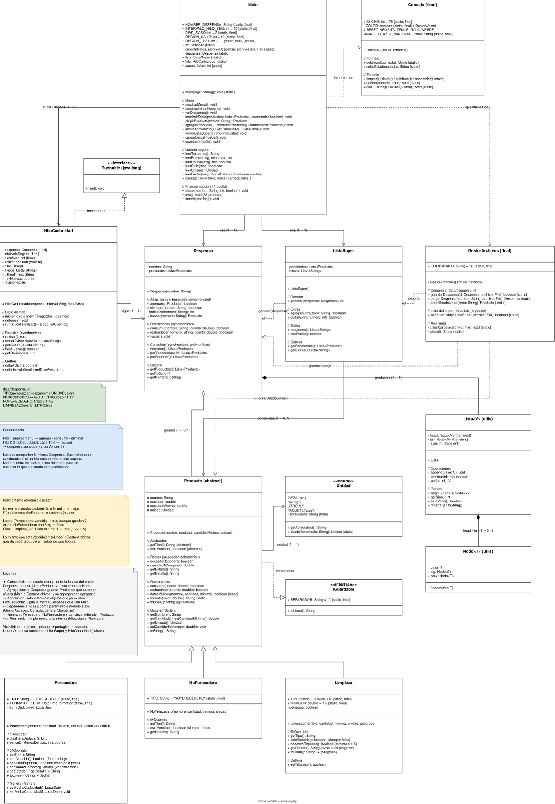

# ReponIt 🛒

**ReponIt** es un programa de terminal en Java para llevar el control de la despensa de casa. Registra lo que tienes, te avisa en segundo plano qué está vencido o por caducar y arma la lista del súper con lo que hace falta. Todo se guarda en archivos de texto, así que al volver a abrirlo tus datos siguen ahí.

Proyecto final de **36282 Programación Orientada a Objetos**, Universidad Autónoma de Baja California (UABC), Facultad de Ciencias Químicas e Ingeniería.


---

## Contenido

- [¿Qué problema resuelve?](#qué-problema-resuelve)
- [Funcionalidades](#funcionalidades)
- [Tecnologías y conceptos](#tecnologías-y-conceptos)
- [Estructura del proyecto](#estructura-del-proyecto)
- [Diseño de clases](#diseño-de-clases)
- [Compilar y ejecutar](#compilar-y-ejecutar)
- [Uso](#uso)
- [Pruebas](#pruebas)
- [Formato de los archivos](#formato-de-los-archivos)
- [Bibliografía](#bibliografía)
- [Autor y licencia](#autor-y-licencia)

---

## ¿Qué problema resuelve?

En casa es común:

- **Tirar comida** porque nadie se acordó de que la leche o el yogurt estaban por caducar.
- **Llegar al súper sin lista**, y comprar de más o regresar sin lo que se había acabado.
- **No saber qué hay** en la alacena sin ir a revisarla.

ReponIt junta las tres cosas en un solo lugar:

1. Llevas un inventario de tu despensa con cantidades y fechas de caducidad.
2. Un hilo en segundo plano revisa las fechas y te avisa de lo vencido y de lo que vence en los próximos 3 días.
3. La lista del súper se genera sola con lo vencido, lo agotado o lo que está por debajo del mínimo. Puedes agregarle extras a mano y exportarla a un `.txt` para llevarla en el celular.

## Funcionalidades

- Alta, consulta, consumo, reabastecimiento y baja de productos.
- Tres tipos de producto con reglas propias:
  - **Perecedero** (leche, pan, huevo): tiene fecha de caducidad; si vence, se repone aunque quede.
  - **No perecedero** (arroz, frijol, atún): nunca vence; se repone por cantidad.
  - **Limpieza** (cloro, jabón): nunca vence; se repone antes de llegar al mínimo y avisa si es peligroso.
- Tabla de la despensa con el estado de cada producto en color (OK, REPONER, AGOTADO, CADUCA, VENCIDO).
- Avisos automáticos de caducidad con un hilo en segundo plano.
- Lista del súper automática + extras, exportable a texto.
- Guardado automático después de cada cambio.
- Fechas en formato `dd/mm/aaaa` o relativas: `+5` = dentro de 5 días.
- Datos de prueba para ver todo funcionando en segundos.

## Tecnologías y conceptos

| Qué | Dónde se usa |
|---|---|
| **Java 11+** (probado con OpenJDK 21) | Todo el proyecto, sin librerías externas |
| **Herencia y clase abstracta** | `Producto` ← `Perecedero`, `NoPerecedero`, `Limpieza` |
| **Polimorfismo** (dynamic dispatch) | `necesitaReponer()`, `estaVencido()` y `toLinea()` responden distinto según la subclase |
| **Interfaces** | `IGuardable`: cada producto sabe escribirse en una línea del archivo |
| **Enumeraciones** | `Unidad` (pieza, kg, litro, paquete) |
| **Genéricos** | `utils.Lista<V>`, lista doblemente enlazada propia |
| **Persistencia en texto** | `GestorArchivos` con `BufferedReader` / `BufferedWriter` en UTF-8 |
| **Concurrencia** | `HiloCaducidad` (`Runnable`, hilo daemon) + métodos `synchronized` en `Despensa` |
| **Manejo de excepciones** | Lectura segura de datos y líneas de archivo mal formadas |
| **Fechas** | `java.time.LocalDate` y `DateTimeFormatter` |
| **Terminal amigable** | Colores ANSI y recuadros (`Consola`) |
| **UML** | Diagrama de clases en `docs/UML.drawio` (draw.io), exportado a SVG y PNG |

**Principios de diseño:** cada clase tiene una sola responsabilidad (`GestorArchivos` solo lee y escribe, `Consola` solo imprime, `HiloCaducidad` solo vigila fechas). `Despensa` no sabe nada de archivos ni de pantalla, y `ListaSuper` trabaja con `Producto` sin conocer sus subclases.

## Estructura del proyecto

```
ReponIt/
├── README.md
├── LICENSE
├── docs/
│   ├── UML.drawio          Diagrama de clases (editable)
│   └── UML.svg             Exportado, el que se muestra en este README
├── src/
│   ├── Main.java           Menú, lectura segura y test() oculto
│   ├── Producto.java       Clase abstracta base
│   ├── Perecedero.java
│   ├── NoPerecedero.java
│   ├── Limpieza.java
│   ├── Unidad.java         enum
│   ├── IGuardable.java     interfaz
│   ├── Despensa.java       Inventario (synchronized)
│   ├── ListaSuper.java
│   ├── GestorArchivos.java Guardar / cargar .txt
│   ├── HiloCaducidad.java  Hilo de avisos
│   ├── Consola.java        Colores y formato
│   └── utils/
│       ├── Lista.java      Lista<V> genérica
│       └── Nodo.java
├── data/                   despensa.txt y lista_super.txt (los crea el programa)
└── output/                 .class compilados (se genera al compilar)
```

## Diseño de clases



*Da clic en la imagen para verla en tamaño completo.* El archivo editable está en [`docs/UML.drawio`](docs/UML.drawio); ábrelo en [app.diagrams.net](https://app.diagrams.net) o con la extensión de draw.io en VS Code.

**Resumen de relaciones:**

- `Perecedero`, `NoPerecedero` y `Limpieza` **heredan** de la clase abstracta `Producto`, que **implementa** `IGuardable`.
- `Despensa` **agrega** productos (◇): se crean afuera, en `Main` o `GestorArchivos`, y se le pasan.
- `Despensa` se **compone** de una `Lista<Producto>` (◆), y la `Lista` de sus `Nodo`.
- `HiloCaducidad` **implementa** `Runnable` y **vigila** la misma `Despensa` que usa `Main`.
- `ListaSuper` **referencia** los productos pendientes; `GestorArchivos` y `Consola` se **usan** como utilidades (dependencias).

## Compilar y ejecutar

**Requisito:** JDK 11 o superior. Verifica con `javac -version`.

Todos los comandos se corren **desde la carpeta del proyecto** (donde está este README).

### Linux / WSL / macOS

```bash
# Si no tienes el JDK (Ubuntu / WSL)
sudo apt install openjdk-21-jdk

# Compilar
javac -encoding UTF-8 -d output $(find src -name "*.java")

# Ejecutar
java -cp output Main
```

### Windows (PowerShell)

```powershell
chcp 65001
javac -encoding UTF-8 -d output (Get-ChildItem -Recurse src -Filter *.java).FullName
java "-Dstdout.encoding=UTF-8" -cp output Main
```

### Si algo se ve raro

| Síntoma | Solución |
|---|---|
| Salen códigos como `[32m` en vez de colores (cmd antiguo de Windows) | Usa Windows Terminal, o ejecuta con `java -Dcolor=false -cp output Main` |
| Salen `?` en lugar de recuadros o acentos | Linux/WSL: `export LANG=C.UTF-8`. Windows: `chcp 65001` antes de ejecutar |
| `javac: command not found` | Instala el JDK (no basta con el JRE) |

## Uso

Al iniciar, el programa carga `data/despensa.txt` (si existe) y arranca el hilo de avisos.

| Opción | Qué hace |
|---|---|
| 1 | Ver la despensa en tabla, con el estado de cada producto |
| 2 | Agregar producto (perecedero, no perecedero o limpieza) |
| 3 | Consumir: resta la cantidad que usaste |
| 4 | Reabastecer: suma lo que compraste (y la fecha nueva si es perecedero) |
| 5 | Eliminar producto |
| 6 | Caducidad: vencidos y los que vencen en los próximos 3 días |
| 7 | Lista del súper: se genera sola; agrega o quita extras y expórtala a `data/lista_super.txt` |
| 8 | Avisos del hilo: estado de `HiloCaducidad` y avisos actuales |
| 9 | Cargar datos de prueba (9 productos con casos de todo tipo) |
| 10 | Guardar y salir |

## Pruebas

### Pruebas automáticas (opción oculta 11)

En el menú escribe **`11`**. No aparece en la lista a propósito. Corre **65 pruebas** sin pedir nada por teclado y al final muestra el resumen `65 OK, 0 fallas`. Usa una carpeta temporal, así que **no toca tus datos**. Los mensajes `Error:` que salen durante la prueba son esperados: son los casos inválidos.

| Bloque | Qué comprueba |
|---|---|
| 1. Productos y validación | Datos válidos e inválidos: nombre vacío, `;` en el nombre, cantidades negativas |
| 2. Polimorfismo | La misma llamada (`necesitaReponer()`, `estaVencido()`, `getTipo()`) da resultados distintos según la subclase |
| 3. Despensa | Agregar, duplicados, buscar, consumir y reabastecer, con casos válidos e inválidos |
| 4. Lista del súper | Generación automática, extras y quitar extras inexistentes |
| 5. Archivos de texto | Guardar y volver a cargar, líneas mal formadas, tipo desconocido, archivo que no existe |
| 6. Eliminar | Eliminar existentes e inexistentes |
| 7. Hilos y `synchronized` | El hilo arranca, revisa y se detiene; **dos hilos modifican la misma despensa** 500 veces cada uno sin perder datos |

### Pruebas manuales sugeridas

1. **Primer arranque:** borra `data/` y ejecuta. Debe abrir con 0 productos y sin errores.
2. **Hilo de avisos:** opción 9, espera unos 10 segundos y presiona Enter. Arriba del menú aparecen los avisos de lo vencido y lo que está por vencer.
3. **Polimorfismo:** con los datos de prueba, opción 7. Entran el yogurt (vencido), el pan, el frijol y el cloro (queda poco), pero **no** el arroz, que todavía tiene suficiente.
4. **Persistencia:** agrega un producto, sal con la opción 10 y vuelve a abrir. El producto sigue ahí y aparece en `data/despensa.txt`.
5. **Archivo editado a mano:** abre `data/despensa.txt`, agrega una línea mal escrita y vuelve a ejecutar. El programa la salta y avisa cuántas líneas ignoró.
6. **Entradas inválidas:** escribe letras donde se pide un número, una fecha con formato incorrecto o una cantidad negativa. Debe volver a preguntar sin tronar.
7. **Fechas relativas:** agrega un perecedero con fecha `+1`. Debe aparecer como "vence en 1 día" en la opción 6.

## Formato de los archivos

### `data/despensa.txt`

Una línea por producto, campos separados por `;`. El primer campo indica qué subclase se crea al cargar.

```
# TIPO;nombre;cantidad;minima;UNIDAD;[fecha yyyy-MM-dd | peligroso]
PERECEDERO;Leche;2;1;LITRO;2026-11-27
NOPERECEDERO;Arroz;2;1;KG
LIMPIEZA;Cloro;1;1;LITRO;true
```

Las líneas que empiezan con `#` son comentarios. Las líneas con formato incorrecto se ignoran y el programa avisa cuántas fueron.

### `data/lista_super.txt`

Lista legible para llevarla en el celular o imprimirla:

```
LISTA DEL SUPER - 26/11/2026 03:06
==========================================
[ ] Yogurt                  4 pz   (vencido)
[ ] Pan                     1 paq  (queda poco)
[ ] Frijol                1.5 kg   (queda poco)
[ ] Cloro                   1 L    (queda poco)
```

## Bibliografía

1. Gaddis, T. (2016). *Starting Out with Java: From Control Structures through Objects* (6.ª ed., Global Edition). Pearson.
2. Horstmann, C. S. (2022). *Core Java, Volume I: Fundamentals* (12.ª ed.). Pearson / Oracle Press.
3. Schildt, H. (2021). *Java: The Complete Reference* (12.ª ed.). McGraw-Hill.
4. Weisfeld, M. (2019). *The Object-Oriented Thought Process* (5.ª ed.). Addison-Wesley.
5. Object Management Group. (2017). *OMG Unified Modeling Language (UML), Version 2.5.1*. https://www.omg.org/spec/UML/2.5.1
6. Oracle. *The Java Tutorials: Concurrency*. https://docs.oracle.com/javase/tutorial/essential/concurrency/
7. Oracle. *Java SE 21 API Specification* (`java.io`, `java.time`, `java.lang.Thread`). https://docs.oracle.com/en/java/javase/21/docs/api/
8. Presentaciones del curso 36282 Programación Orientada a Objetos, UABC FCQI (2026-2): Clases y objetos, Herencia y polimorfismo, Interfaces, Clases abstractas, Genéricos, Cohesión y acoplamiento, Serialización.

## Autor y licencia

**Joshua Osorio Osorio**: [GitHub](https://github.com/joeOsorio) · [LinkedIn](https://www.linkedin.com/in/joshua-osorio-osorio-603a08323/)

Ingeniería en Computación, UABC Tijuana. Noviembre 2026.

Distribuido bajo la licencia MIT. Consulta [`LICENSE`](LICENSE).
